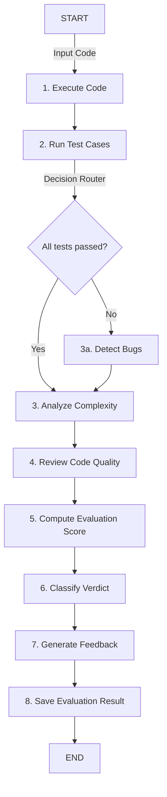

# Code Evaluation Agent - Architecture & Execution Guide

The **Code Evaluation Agent** is a sophisticated, multi-node agentic workflow built using **LangGraph** and integrated into the **AI Coding Practice Coach** platform. Its purpose is to go beyond traditional test-pass/fail checks by performing a deep, human-like evaluation of a user's code solution, inspecting it for **correctness, execution efficiency, algorithmic complexity, and styling quality**.

---

## 🏗️ 1. High-Level Architecture & Workflow

The agent operates as a state machine using a **LangGraph** pipeline with a sequence of 8 specialized execution nodes and an intelligent decision router:



---

## 💾 2. State Management (`AgentState`)

The entire execution state is tracked and updated progressively by nodes using a shared `AgentState` schema. This state flows from node to node:

| State Key       | Type     | Description                                                                             |
| :-------------- | :------- | :-------------------------------------------------------------------------------------- |
| `userId`        | `string` | The unique ID of the user.                                                              |
| `problemId`     | `string` | The unique ID of the question.                                                          |
| `submittedCode` | `string` | The raw code submitted by the user.                                                     |
| `language`      | `string` | The programming language (e.g., `javascript`, `python`).                                |
| `testCases`     | `Array`  | The list of test inputs and expected outputs.                                           |
| `execResult`    | `Object` | Base execution details (stdout, stderr, exit code).                                     |
| `testResults`   | `Object` | Structured results containing individual test outcomes (passed/failed, actual outputs). |
| `complexity`    | `Object` | Calculated Big-O time and space complexity results.                                     |
| `qualityReview` | `Object` | Code quality score ($0$–$100$), grade, and specific linting/formatting issues.          |
| `bugReport`     | `Object` | Target bug details if test cases fail (category, line number, hint).                    |
| `evalScore`     | `number` | The computed weighted final score ($0$–$100$).                                          |
| `verdict`       | `string` | The final status (`Pass`, `Partial Pass`, or `Fail`).                                   |
| `feedback`      | `Array`  | Tailored AI coach recommendations.                                                      |
| `error`         | `string` | Any system or compiler error encountered.                                               |

---

## ⚙️ 3. Detailed Node Executions (The 8 Nodes)

### 🟢 Node 1: Execute Code (`executeCode`)

- **Purpose**: Runs a quick test execution of the code to ensure it compiles and runs without immediate syntax or compilation errors.
- **Sandbox**: Executes the code inside a secure local process worker or a sandboxed container using a structured timeout limits ($5000\text{ms}$) and memory caps ($128\text{MB}$).

### 🟢 Node 2: Run Test Cases (`runTests`)

- **Purpose**: Runs the solution against all public and hidden test cases.
- **Deserialization (Trees & Graphs)**: Detects if the question is a tree-based problem (e.g., _Same Tree_ or _Lowest Common Ancestor_). If so, it injects a **TreeNode** structure and dynamically deserializes flat array inputs into binary tree structures before invoking the user's function.
- **Output**: Compares the actual output with the expected output using a tolerance matcher (e.g., for numeric approximations or whitespace normalization).

### 🔀 Decision Router (`decide`)

- **Purpose**: Inspects the test suite results. If **any** test case failed, it routes to `detectBugs`. If all tests passed, it skips directly to `analyzeComplexity` to optimize execution time.

### 🟡 Node 3a: Detect Bugs (`detectErrors`)

- **Purpose**: Diagnoses logic and runtime errors.
- **Functionality**: Uses regular expressions and LLM patterns to inspect the failed outputs. It categorizes the error (e.g., `logic_error`, `runtime_error`, `timeout`) and extracts a specific hint directing the user toward the buggy edge-case (e.g., handling null roots, empty trees, or negative boundaries).

### 🟢 Node 3: Analyze Complexity (`analyzeComplexity`)

- **Purpose**: Determines the algorithmic complexity of the code.
- **Functionality**: Uses static code analysis to inspect the loops and recursion depths:
  - Single loops or linear recursions are classified as $O(N)$ Time.
  - Nested loops are classified as $O(N^2)$ Time.
  - Solutions matching optimal constraints are marked as `Optimal`.

### 🟢 Node 4: Review Code Quality (`reviewCode`)

- **Purpose**: Evaluates readability, style, and structure.
- **Functionality**: Inspects the code for standard best practices, checking for:
  - Proper variable/function naming conventions.
  - Redundant or dead code paths.
  - Presence of descriptive comments and docstrings.
- **Output**: Generates a quality score out of $100$ and a grade (e.g., `Excellent`, `Good`, `Poor`).

### 🟢 Node 5: Compute Score (`computeScore`)

- **Purpose**: Computes a balanced, holistic evaluation score from $0$ to $100$.
- **Formula**:
  $$\text{Final Score} = (\text{Correctness} \times 0.50) + (\text{Complexity Score} \times 0.30) + (\text{Code Quality} \times 0.20)$$
  - _Correctness (50%)_: Proportional to the ratio of passed test cases.
  - _Complexity (30%)_: Evaluated based on whether the time/space complexities meet optimal thresholds.
  - _Code Quality (20%)_: Directly mapped to the structural quality score.

### 🟢 Node 6: Classify Verdict (`classifyVerdict`)

- **Purpose**: Sets the final run category.
- **Criteria**:
  - `Pass`: Score $\ge 70$ and **all** test cases passed.
  - `Partial Pass`: Score $\ge 50$ but some test cases failed.
  - `Fail`: Score $< 50$ or compiler/execution crash.

### 🟢 Node 7: Generate Feedback (`generateFeedback`)

- **Purpose**: Formulates actionable AI advice.
- **Functionality**: Aggregates the findings from correctness, complexity, and quality reviews, and formats them into a structured, readable list of bulleted points for the learner.

### 🟢 Node 8: Save Result (`saveEvalResult`)

- **Purpose**: Persists the execution metadata in the database.
- **Functionality**: Uses Prisma to write a new `Submission` record. For security and relational integrity, it validates user existence before linking the relationship (falling back to `'anonymous'` if required). The complete agentic evaluation report is serialized into the `Submission.stdout` field as a JSON payload for future history retrieval.

---

## 📡 4. Real-time Event Streaming (WebSockets)

To deliver a premium, responsive UX, the backend streams progress updates in real time using a dependency-free WebSocket server running on port `8001`:

1.  When a node starts execution, the backend logs it.
2.  Once a node completes (or throws an error), the backend immediately broadcasts a structured frame:
    ```json
    {
      "event": "node_complete",
      "node": "runTests",
      "status": "done",
      "duration_ms": 473,
      "timestamp": "2026-06-22T17:16:32.013Z"
    }
    ```
3.  The frontend client listens on `ws://localhost:8001` and dynamically transitions the corresponding trace node in the UI.

---

## 🎨 5. Frontend User Interface

The evaluation results are rendered inside a sliding **Evaluation Panel** in the code workspace:

- **Verdicts & Gauge**: Displays a dynamic circular progress ring. The theme adjusts to match the verdict (Emerald green for `Pass`, Amber for `Partial Pass`, and Rose red for `Fail`).
- **Execution Trace Pipeline**: A vertical stepper reflecting each LangGraph node. It shows real-time spinners while executing and updates to green checkmarks (or red hazard signs) with exact millisecond timings once finished.
- **Interactive Test Case List**: Let's users click and expand each test case to compare the input parameters, expected result, and actual output.
- **Complexity & Quality Cards**: Displays structural analysis metrics (e.g., Time: $O(N)$, Space: $O(1)$) with an `Optimal` badge, alongside code quality details.
- **AI Coach Feedback**: Highlights clear, structured bulleted points detailing correctness, bug explanations, performance, and style tips.

---

## 🛠️ 6. Core Fixes & Platform Alignment

During the integration, two major platform issues were resolved to ensure a seamless experience:

1.  **Strict-Mode WebSocket Warnings**: Solved browser warnings where React Strict-Mode closed connections during double-renders by implementing a connection callback cleanup state.
2.  **Standard "Run Code" Deserialization**: Fixed a major platform bug where clicking **Run** passed raw flat arrays to tree-based questions (which made incorrect array-based solutions falsely pass), aligning it with the agentic evaluation by adding `deserializeTree()` wrappers.
