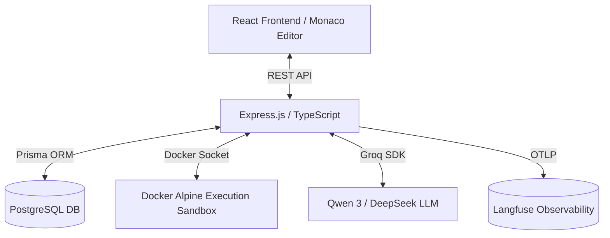
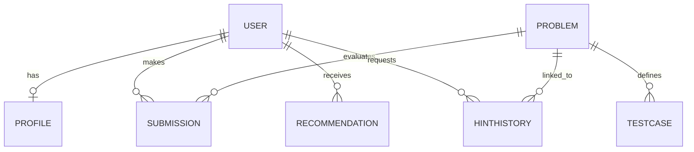

# Project Memory: AI-Powered Coding Practice Coach
**Squad:** Skill Lens (SQUAD-02)

---

## 1. Project Overview

### Problem Statement
Self-directed coding practice platforms (e.g., LeetCode, HackerRank) present users with static test suites and pass/fail outputs. They lack contextual mentoring, conceptual debug guidance, personalized problem recommendation based on skill gaps, and secure real-time code sandboxing. Users often get stuck, look up solutions directly, and bypass the critical "struggle" phase of learning.

### Target Users
- Aspiring software engineers looking to build core programming proficiency.
- Intermediate developers practicing data structures, algorithms, and secure coding patterns.
- Students needing immediate conceptual debugging guidance without relying on copy-paste code generators.

### Key Objectives
- **Interactive Mentorship**: Introduce a conversational AI coach that provides conceptual advice and progressive hints rather than direct answers.
- **Dynamic Curriculum**: Automatically suggest coding problems targeted at addressing detected user skill gaps.
- **Secure Sandboxed Execution**: Allow users to run code dynamically in isolated environments (Docker/local fallbacks) with strict constraints.
- **Actionable Complexity Analysis**: Measure code runtime, memory usage, and structural complexity.

### Core Features
- Monaco Editor-based workspace with support for JavaScript and Python.
- Dynamic sandbox process execution (via Docker or local fallback).
- Global Request ID logging and robust error handling.
- Multi-agent routing graph for profiling, problem generation, evaluation, and mentoring.

### MVP Scope
- **Languages**: JavaScript (Node.js) and Python.
- **API Endpoints**: Run code (transient), submit code (persistent), retrieve submissions, register/authenticate users, fetch problems, request hints.
- **Runners**: Standard child process spawner with CPU/memory limits, 5s timeout, 1MB output cap, and Docker container isolation.

### Out-of-Scope Features
- Multi-language compilers (e.g., C++, Java, Rust) for initial versions.
- Interactive multi-user coding rooms / WebSocket collaborative editor sessions.
- Direct code generation features (to prevent cheating).

---

## 2. Final Architecture Decisions



### Frontend
- **React 18 & TypeScript**: Chosen for component reusability, rich developer tooling, static type safety, and fast rendering.
- **Vite**: Provides ultra-fast hot module replacement (HMR) and optimized production bundles, replacing bulky Webpack builds.
- **Tailwind CSS & shadcn/ui**: Offers modern, Harmonious styles and standard accessible components out-of-the-box, saving frontend layout design overhead.
- **TanStack Router**: Type-safe routing for single-page applications, reducing navigation-related runtime exceptions.
- **Monaco Editor (`@monaco-editor/react`)**: The industry standard for online editors, providing syntax highlighting, autocomplete, and editor layout parity with VS Code.

### Backend
- **Node.js & Express.js**: High-throughput asynchronous runtime allowing fast API request-response handling and simple integration with child process streams and the Docker CLI.
- **TypeScript**: Establishes typing standards across routes, validators, repositories, and services, preventing runtime spelling and null-reference bugs.
- **PostgreSQL**: Robust relational database ideal for transactions, linked relational data (users, profiles, submissions, problems), and supports vector extensions (`pgvector`) for storing skill embeddings.
- **Prisma ORM**: Strongly-typed client library to map DB tables to TypeScript interfaces, auto-generating schema migrations.
- **Zod**: Type-safe parsing and schema validation middleware for API request payloads.

### AI Layer (Multi-Agent Architecture)
Our AI orchestrator is built on **LangGraph JS** and structured around a **Supervisor Agent** coordinating routing logic:
- **Supervisor Agent**: The coordinator. Parses user workspace events, coordinates data flow, and routes queries to specific child agents.
- **Profile & Skill Agent**: Evaluates user profiles, calculates progress embeddings, and maintains user skill profiles (identifying weak/strong concepts).
- **Problem Generation Agent**: Crafts personalized programming questions fitting the student's proficiency level and concepts to review.
- **Evaluation Agent**: Analyzes code syntax, validates logic against test cases, and calculates algorithmic complexity.
- **Mentor Agent**: Acts as the user's tutor. Inspects code execution failures and provides progressive, conceptual hinting without leaking direct solutions.

### Observability
- **Langfuse**: Captures agent tracing, prompt inputs/outputs, latency, tokens consumed, and cost metrics to ensure AI agent performance and monitor prompt quality.

---

## 3. Agent Workflow

```text
User Workspace
     ↓
Supervisor Agent (Decides next action)
     ↓
Profile Agent (Loads/Analyzes user metrics)
     ↓
Problem Gen Agent (Generates customized coding challenge)
     ↓
User Solves Problem (Uses Monaco Editor to code)
     ↓
Evaluation Agent (Executes code + checks correctness)
     ↓
Mentor Agent (Interprets result, provides hints on failure)
     ↓
Profile Update (Increments points, maps new gaps)
```

- **Inputs**: Code workspace language, code input string, historical attempts, and profile state.
- **Outputs**: Hints, syntax diagnostics, code correct/incorrect results, and new problem definitions.
- **State/Memory Transitions**:
  - The supervisor reads state variables from the graph.
  - Profile agent adjusts score metrics:
    - Successful Run: Upgrades skill level rating.
    - Repeated Failure / Hint requested: Logs difficulty gap.
- **Future Improvements**:
  - Pre-warmed caching of agent suggestions.
  - Multi-user comparative metrics dashboard.

---

## 4. Database Design

### Major Entities



1. **User**: Credentials, profiles, emails, and base verification details.
2. **Profile / SkillProfile**: Vector representations of a user's skills per topic (e.g., Arrays, Trees, Sorting).
3. **Problem**: Challenge description, title, difficulty (`EASY`, `MEDIUM`, `HARD`), tag classification, and constraints.
4. **TestCase**: Standard test inputs and expected outputs for problem verification (marked public/private).
5. **Submission**: Logged attempt details containing language, execution code, execution metrics, correctness status, and error logs.
6. **HintHistory**: Record of hints requested by the user, saving context so the mentor agent does not repeat advice.
7. **Recommendation**: Targeted questions queued for a user based on their skill profile.

### Enums
- **Language**:
  ```prisma
  enum Language {
    JAVASCRIPT
    PYTHON
  }
  ```
- **SubmissionStatus**:
  ```prisma
  enum SubmissionStatus {
    ACCEPTED           // Execution succeeded and passed all test cases
    RUNTIME_ERROR      // Exception thrown during execution
    COMPILATION_ERROR  // Syntax or translation error
    TIMEOUT            // Execution exceeded 5 seconds limit
    FAILED             // Host sandbox execution error
  }
  ```

---

## 5. Code Execution Architecture

```text
Frontend Monaco Editor
        ↓ (sends language + code)
POST /api/run  or  POST /api/submit
        ↓
CodeExecutionService
        ↓ (checks Docker availability via DockerDetector)
Available? ── Yes ──> Docker Sandbox (docker run -i --rm node/python)
        └── No ───> Local Process Sandbox (spawn node/python3)
        ↓
ProcessExecutor (pipes code via stdin, monitors output/time)
        ↓
ExecutionResult (truncates output, maps errors, returns response)
```

### Execution-Related Decisions
- **Docker Sandbox Mode**: Executes code in an isolated container using `--memory=128m --cpus=0.5` limits and standard alpine packages (`node:18-alpine` or `python:3.10-alpine`).
- **Local Fallback Mode**: Fallback to local host binaries (`node` with `--max-old-space-size=128`, `python3` or `python` on Windows) if the Docker daemon is unavailable, printing a startup warning.
- **Stdin Pipe Injection**: Code is streamed to the executor process stdin instead of writing a local file, completely avoiding file layout and shell quote-escaping vulnerabilities.
- **Enforced Limits**:
  - **Timeout**: `5000ms`. Kill process with `SIGKILL` on timeout.
  - **Output Buffer**: `1MB` max for `stdout` / `stderr`. If exceeded, execution terminates instantly and maps `outputTruncated: true`.
  - **Source Code**: Limit code request payload size to `64KB`.

---

## 6. API Contracts

### `GET /api/questions`
- **Purpose**: Retrieve a list of programming problems. Supports pagination and difficulty filters.
- **Request Query**: `?page=1&limit=10&difficulty=MEDIUM`
- **Response (200)**:
  ```json
  {
    "success": true,
    "data": [
      {
        "id": "q_1",
        "title": "Two Sum",
        "difficulty": "EASY",
        "tags": ["Arrays", "Hash Table"]
      }
    ],
    "pagination": { "page": 1, "totalPages": 5 }
  }
  ```

### `GET /api/questions/:id`
- **Purpose**: Get detail of a specific problem.
- **Response (200)**:
  ```json
  {
    "success": true,
    "data": {
      "id": "q_1",
      "title": "Two Sum",
      "description": "Given an array of integers...",
      "difficulty": "EASY",
      "constraints": ["2 <= nums.length <= 104"]
    }
  }
  ```

### `POST /api/run`
- **Purpose**: Execute code in the sandbox without saving it in the database.
- **Request Body**:
  ```json
  {
    "language": "javascript",
    "sourceCode": "console.log('Testing code execution');"
  }
  ```
- **Response (200)**:
  ```json
  {
    "success": true,
    "status": "ACCEPTED",
    "stdout": "Testing code execution\n",
    "stderr": "",
    "executionTime": 84,
    "memoryUsed": 0,
    "outputTruncated": false
  }
  ```

### `POST /api/submit`
- **Purpose**: Execute code, evaluate against test suites, save results, and return submission details.
- **Request Body**:
  ```json
  {
    "language": "python",
    "sourceCode": "print('Evaluate submission')",
    "userId": "usr_123"
  }
  ```
- **Response (201)**:
  ```json
  {
    "submissionId": "sub_9876",
    "status": "ACCEPTED",
    "executionTime": 120,
    "memoryUsed": 0
  }
  ```

### `GET /api/submissions/:id`
- **Purpose**: Fetch details of a previous submission.
- **Response (200)**:
  ```json
  {
    "success": true,
    "data": {
      "id": "sub_9876",
      "language": "PYTHON",
      "status": "ACCEPTED",
      "sourceCode": "print('Evaluate submission')",
      "stdout": "Evaluate submission\n",
      "stderr": "",
      "executionTime": 120,
      "memoryUsed": 0,
      "outputTruncated": false,
      "createdAt": "2026-06-10T04:39:05.166Z",
      "userId": "usr_123"
    }
  }
  ```

### `GET /api/progress/:userId`
- **Purpose**: Retrieve the user's solved statistics and skill radar details.
- **Response (200)**:
  ```json
  {
    "success": true,
    "userId": "usr_123",
    "stats": { "solved": 15, "easy": 10, "medium": 5, "hard": 0 },
    "skills": [
      { "topic": "Arrays", "score": 85 },
      { "topic": "Trees", "score": 40 }
    ]
  }
  ```

### `GET /api/recommendations/:userId`
- **Purpose**: Fetch recommended problems queued by the AI profiling system.
- **Response (200)**:
  ```json
  {
    "success": true,
    "recommendations": [
      {
        "problemId": "q_9",
        "title": "Binary Tree Inorder Traversal",
        "reason": "Recommended to practice Trees (current skill rating: 40%)"
      }
    ]
  }
  ```

---

## 7. Folder Structure

### Frontend (`/frontend`)
```text
src/
├── assets/                 # SVGs, images, static styles
├── components/             # Reusable UI elements (Buttons, Dropdowns)
├── config/                 # Routes config, network clients
├── features/               # Cohesive module layers
│   ├── authentication/     # Signup, Login, Profile cards
│   ├── code-editor/        # Monaco container, Console, Output window
│   ├── problems/           # Problems list, Description panel
│   ├── submissions/        # Submissions history tables
│   ├── mentor/             # Conversational AI assistant interface
│   ├── recommendations/    # Profile skill progression lists
│   └── dashboard/          # Student main statistics panel
├── layouts/                # Navbars, App shell containers
└── services/               # Api connections client
```

### Backend (`/backend`)
```text
src/
├── config/                 # Server environment maps
├── middlewares/            # Request ID, global errors, Zod parsers
├── database/               # Prisma client database bindings
├── shared/                 # Common elements
│   ├── errors/             # AppError, BadRequestError class definitions
│   ├── utils/              # Custom logger context maps
│   ├── validators/         # Common schemas
│   └── types/              # Cross-boundary typings
│
├── execution/              # Sandbox execution engine
│   ├── runners/            # Target compilers (Javascript, Python)
│   ├── services/           # CodeExecutionService orchestration
│   ├── sandbox/            # DockerDetector & ProcessExecutor
│   └── types/              # ICodeRunner execution result typings
│
├── features/               # Feature domain modules
│   └── submissions/
│       ├── routes/         # Routing maps
│       ├── controllers/    # Express route controller actions
│       ├── services/       # Database CRUD orchestration
│       ├── repository/     # Direct database access queries
│       └── schemas/        # Zod validation schemas
│
├── app.ts                  # App initializers
└── server.ts               # HTTP startup server
```
*Feature-based Architecture*: Groups files together by feature domain (e.g., `submissions/`) rather than by code category (`routes/`, `controllers/` globally). This makes features self-contained and easy to modularize or scale into separate microservices later if necessary.

---

## 8. Development Standards

### Coding Standards
- **TypeScript Strict Mode**: Enable strict checks (`noImplicitAny`, `strictNullChecks`, `strictBindCallApply`).
- **ESLint**: Enforces clean import order, catches unsanctioned `console.log` statements, and requires TS standards.
- **Prettier**: Consistent styling with `printWidth: 100`, `singleQuote: true`, `semi: true`, and `trailingComma: all`.

### Architecture Standards
- **Controller → Service → Repository**: Controllers parse requests, services process domain business logic, and repositories query database structures.
- **Zod Validation**: Guard all endpoint entries with Zod middleware.
- **Centralized Error Handling**: Express controllers throw custom `AppError` subclasses. The global `errorMiddleware` formats these exceptions into clean, unified JSON structures.

### Naming Conventions
- **Components**: PascalCase (e.g., `LanguageSelector.tsx`).
- **Services/Repositories/Controllers**: camelCase (e.g., `submissionRepository`, `submissionController`).
- **Routes**: kebab-case URLs, e.g., `/api/submissions/:id`.
- **Database Models**: PascalCase singular (e.g., `Submission`).
- **Agents**: PascalCase ending with Agent (e.g., `SupervisorAgent`).

---

## 9. Environment Variables

- `PORT`: Server port (default `8000`).
- `NODE_ENV`: Application execution state (`development` or `production`).
- `DATABASE_URL`: Connection URL for PostgreSQL.
- `USE_DOCKER_SANDBOX`: Toggles containerized sandbox execution (`true`/`false`).
- `SANDBOX_TIMEOUT_MS`: Time limit before terminating code execution (default `5000`).
- `SANDBOX_MEMORY_LIMIT_MB`: Docker memory cgroups ceiling (default `128`).
- `BETTER_AUTH_SECRET`: Secret key for authentication payload hashing.
- `BETTER_AUTH_URL`: Canonical backend auth URL context.
- `GROQ_API_KEY`: API authorization key for LLM prompting.
- `LANGFUSE_PUBLIC_KEY`: Observability dashboard ingestion public credentials.
- `LANGFUSE_SECRET_KEY`: Observability dashboard ingestion secret credentials.
- `LANGFUSE_HOST`: Observability host endpoint.

---

## 10. Security Decisions
- **Docker Sandboxing**: Executes untrusted code inside isolated containers with limited memory and CPU.
- **Input Sanitization**: Rejects payloads exceeding 64KB, preventing RAM attacks.
- **Timeout Enforcer**: Process is killed using `SIGKILL` if it runs longer than 5 seconds.
- **Output Truncation**: Caps stdout/stderr logs at `1MB` to prevent buffer overflow/exhaustion.
- **Process Memory Checkers**: Samples process footprints using `pidusage` to track local process execution footprints.

---

## 11. Risks & Assumptions

### Risks
- **AI Hallucination**: The Mentor Agent might suggest incorrect hints or evaluate code complexity wrongly.
  - *Mitigation*: Strictly configure LLM temperature parameters (< `0.2`) and validate responses against structured JSON schemas.
- **Third-Party AI Dependency**: Rate limiting or downtime on Groq API.
  - *Mitigation*: Implement runtime retries with exponential backoffs and build fallback local rules for standard exceptions.
- **Prompt Injection**: Users might prompt the mentor chat to reveal the final code solution.
  - *Mitigation*: Prepend strong system prompts instruction sets forbidding code leaks, and run prompt filters.

---

## 12. Team Responsibilities
- **Frontend**: UX layouts, Monaco component integration, dashboard.
- **Backend & Database**: Express routes, Prisma schema migrations, global exception handling.
- **Execution Engine**: Process executors, Docker sandbox configurations, environment fallbacks.
- **AI Agents**: LangGraph workflows, prompt engineering, Langfuse observability.

---

## 13. Future Roadmap

### Phase 1 (Core Infrastructure)
- Monaco Editor integrations.
- Secure sandboxed execution engine (JavaScript & Python).
- Core REST API endpoints and database schema migrations.

### Phase 2 (AI Orchestrator)
- Evaluation Agent integration to check correctness.
- Mentor Agent interface for conversational help.
- Profiler recommendations pipeline.

### Phase 3 (Advanced Features)
- Multi-language compilation (Java, C++, Go).
- Interactive peer programming workspaces.
- Real-time learning analytical dashboards.

---

## 14. Critical Decisions Log

### 1. Multi-Agent Architecture over Single-Agent Architecture
- **Reason**: Single prompts struggle to handle grading, profiling, hint generation, and question generation concurrently without degradation. Dividing roles among specialized agents ensures prompt efficiency and improves debugging accuracy.

### 2. PostgreSQL over MongoDB
- **Reason**: Strong relational constraints (users, attempts, profiles, and problem sets) prevent structural desyncs. PostgreSQL also supports `pgvector` for comparing skill profiles, keeping data logic unified.

### 3. Monaco Editor
- **Reason**: Industry standard with rich auto-completion, VS Code keyboard shortcut bindings, and clean modular component wrappers.

### 4. Docker Sandboxing (Piped Stdin)
- **Reason**: Writing files dynamically on Windows/Linux host platforms introduces race conditions and directory leaks. Passing code directly via stdin prevents shell escaping injection completely.

### 5. Groq + Qwen 3
- **Reason**: Exceedingly high throughput speed (token generation rates) with strong performance on code translation and classification, reducing latency.

### 6. Prisma ORM
- **Reason**: Simplifies PostgreSQL modeling, generates TypeScript clients automatically, and maintains structural parity across migrations.
