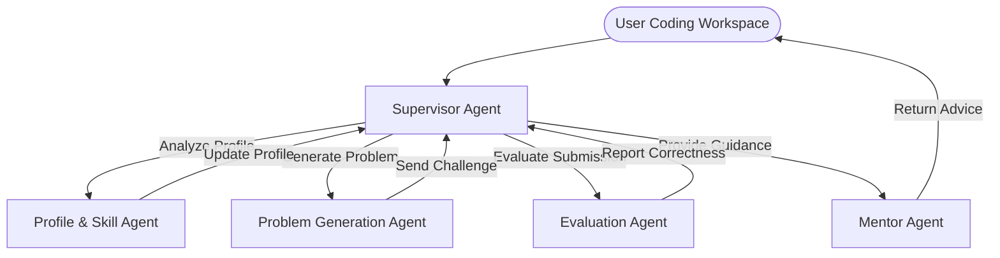

# AI-Powered Coding Practice Coach

A professional monorepo setup for an AI-Powered Coding Practice Coach. This platform helps developers practice coding challenges, providing real-time evaluation, feedback, and mentoring via a multi-agent AI system.

## 🚀 Technology Stack

### Frontend
* **Core**: React 18, TypeScript, Vite
* **Routing**: TanStack Router
* **Styling**: Tailwind CSS & shadcn/ui components
* **Editor**: Monaco Editor (`@monaco-editor/react`)
* **Auth**: BetterAuth Client

### Backend
* **Core**: Node.js, Express, TypeScript (pnpm workspaces)
* **ORM & DB**: PostgreSQL with Prisma ORM and `pgvector` extension
* **AI Orchestration**: LangGraph JS (`@langchain/langgraph`)
* **LLM Engine**: Groq SDK (running Qwen 3 models)
* **Observability**: Langfuse tracing and analytics

---

## 🤖 Multi-Agent Architecture

The AI layer is structured around a centralized **Supervisor Agent** routing system built with LangGraph:



* **Supervisor Agent**: Parses user interactions, coordinates routing, updates high-level graph state, and determines the next specialized agent to execute.
* **Profile & Skill Agent**: Tracks student proficiency across programming domains, updates skill vector embeddings, and pinpoints knowledge gaps.
* **Problem Generation Agent**: Creates tailored, context-specific coding problems based on the student's current skill profile and historical attempts.
* **Evaluation Agent**: Runs code execution safety checks, runs test suites, and assesses code complexity (time/space).
* **Mentor Agent**: Formulates helpful conceptual advice, identifies design anti-patterns, and conducts simulated follow-up interview questions.

---

## 📁 Monorepo Folder Structure

```text
ai-coding-practice-coach/
├── .github/                  # GitHub Actions CI/CD and Templates
│   ├── workflows/            # Frontend build, backend build, and lint checks
│   └── pull_request_template.md
├── docs/                     # Architectural specs, API contracts, and guides
│   ├── architecture/
│   ├── api-contracts/
│   ├── workflows/
│   └── charter/
├── frontend/                 # React client package
│   ├── public/
│   ├── src/
│   │   ├── assets/           # Statics & images
│   │   ├── components/       # Global common and shadcn/ui components
│   │   ├── config/           # App settings
│   │   ├── features/         # Feature-based folder architecture
│   │   │   ├── authentication/
│   │   │   ├── problems/
│   │   │   ├── code-editor/
│   │   │   ├── submissions/
│   │   │   ├── mentor/
│   │   │   ├── recommendations/
│   │   │   └── dashboard/
│   │   └── services/         # api-client.ts and auth-service.ts
│   ├── tailwind.config.js    # Tailwind styling config
│   ├── components.json       # shadcn/ui registry setup
│   └── vite.config.ts        # Vite client builder config
├── backend/                  # Node/Express backend application
│   ├── prisma/               # Prisma schema and db migrations
│   ├── src/
│   │   ├── ai/               # LangGraph multi-agent flow
│   │   │   ├── supervisor-agent/ # Graph, state & workflow configs
│   │   │   └── tools/        # Code execution, review, complexity and recommendations
│   │   ├── database/         # Prisma client configurations and seed script
│   │   ├── features/         # Feature-specific routes, controllers, and services
│   │   └── providers/        # Third party wrappers (Groq, Postgres, LangGraph)
│   └── .env.example          # Environment variables template
├── docker-compose.yml        # PostgreSQL & pgvector container configuration
├── pnpm-workspace.yaml       # pnpm monorepo workspace definition
└── tsconfig.json             # Root TypeScript configurations
```

---

## ⚙️ Setup and Installation

### Prerequisites
* **Node.js** (v20+ recommended)
* **pnpm** (v9+ recommended)
* **Docker & Docker Compose**

### Running Locally

1. **Install Dependencies**
   ```bash
   pnpm install
   ```

2. **Start Infrastructure Services**
   Spin up the PostgreSQL database container with pgvector:
   ```bash
   docker-compose up -d
   ```

3. **Configure Environment Variables**
   Create a `.env` file in the `backend/` directory:
   ```bash
   cp backend/.env.example backend/.env
   ```
   Add your respective Groq API Key and Langfuse tracking keys.

4. **Initialize Database and Schema**
   ```bash
   pnpm --filter backend prisma migrate dev
   ```

5. **Start Development Servers**
   To launch both frontend and backend concurrently:
   ```bash
   pnpm dev
   ```
   * Frontend: `http://localhost:3000`
   * Backend API: `http://localhost:8000`
