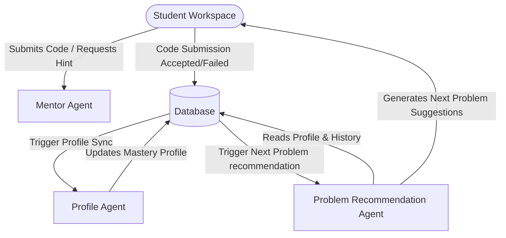
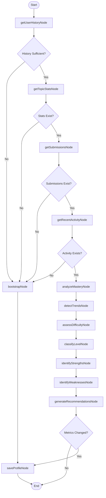
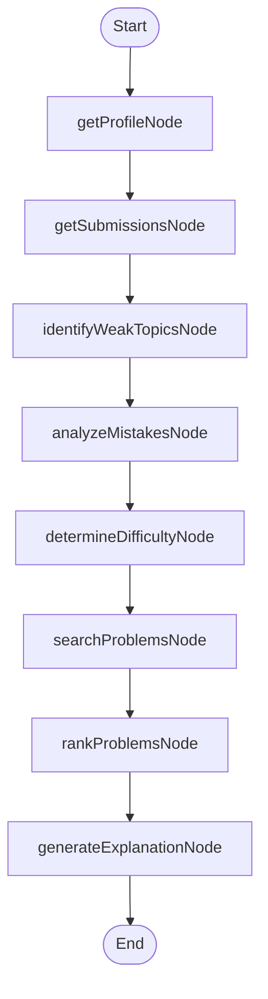

# AI Coding Coach: Agents Architecture & Design

This document details the architecture, internal structures (graphs, nodes, and tools), and interaction patterns of the three specialized agent systems in the **AI Coding Coach** platform:

1. **Mentor Agent** (Real-time Socratic Tutor)
2. **Profile Agent** (Background Mastery Modeling)
3. **Problem Recommendation Agent** (Dynamic Adaptive Learning Path)

---

## Architecture Overview

The system uses a combination of structured decision-making code, stateful graph orchestration (**LangGraph**), and specialized tools to manage the student's learning journey.



---

## 1. Mentor Agent

### Responsibilities
The **Mentor Agent** acts as an experienced, Socratic coding tutor. It operates directly inside the code editor workspace, responding when a student encounters compilation errors, test failures, or requests a hint. It is strictly constrained to **never** leak direct solution code and to guide the student using conceptual prompts.

### Core Workflow (Sequential Pipeline)
Unlike the other agents, the Mentor Agent utilizes a highly optimized sequential evaluation pipeline in [mentor-agent/index.ts](file:///c:/A/PROJECT/Practice/Ai-Coding-coach/backend/src/ai/mentor-agent/index.ts):

1. **Cache Check:** Verifies if a identical prompt/hint has been generated recently to avoid duplicate LLM calls.
2. **History Retrieval:** Checks [hint-store.ts](file:///c:/A/PROJECT/Practice/Ai-Coding-coach/backend/src/ai/mentor-agent/hint-store.ts) to find past guidance given to the user for this problem.
3. **Classification:** Uses [classifier.ts](file:///c:/A/PROJECT/Practice/Ai-Coding-coach/backend/src/ai/mentor-agent/classifier.ts) to categorize the error type (compilation, runtime, logic, timeout, or general conceptual question).
4. **Escalation Tuning:** Uses [escalation.ts](file:///c:/A/PROJECT/Practice/Ai-Coding-coach/backend/src/ai/mentor-agent/escalation.ts) to increment the hint level (Level 1: Concept Clue, Level 2: Point of Error, Level 3: Pseudocode/Dry Run, Level 4: Guardrail Redirect) depending on prior attempts.
5. **LLM Generation:** Calls the primary LLM (Groq Llama 3.3 / fallback Gemini) to synthesize a Socratic response.
6. **Guardrail Check:** Automatically validates the LLM response via [guardrail.ts](file:///c:/A/PROJECT/Practice/Ai-Coding-coach/backend/src/ai/mentor-agent/guardrail.ts) to guarantee no complete function code blocks leak.

---

## 2. Profile Agent

### Responsibilities
The **Profile Agent** compiles the student's mastery profile. Whenever a student submits code, a background process invokes this agent to calculate key stats, evaluate strengths/weaknesses across 10 core computer science concepts (e.g., Arrays, Dynamic Programming, Graphs), and save the updated profile.

### LangGraph Topology
The Profile Agent is organized as a stateful graph orchestrated in [profileGraph.ts](file:///c:/A/PROJECT/Practice/Ai-Coding-coach/backend/src/ai/profile-agent/profileGraph.ts).



### Core Tools
Located in [profile-agent/tools/](file:///c:/A/PROJECT/Practice/Ai-Coding-coach/backend/src/ai/profile-agent/tools/):
* **[getUserHistory](file:///c:/A/PROJECT/Practice/Ai-Coding-coach/backend/src/ai/profile-agent/tools/getUserHistory.ts):** Queries the user's solved question counts, attempts, and overall status.
* **[getTopicStats](file:///c:/A/PROJECT/Practice/Ai-Coding-coach/backend/src/ai/profile-agent/tools/getTopicStats.ts):** Aggregates pass rates, speeds, and memory performance broken down by topic tags.
* **[getSubmissions](file:///c:/A/PROJECT/Practice/Ai-Coding-coach/backend/src/ai/profile-agent/tools/getSubmissions.ts):** Pulls the raw submissions array to analyze coding errors and patterns.
* **[getRecentActivity](file:///c:/A/PROJECT/Practice/Ai-Coding-coach/backend/src/ai/profile-agent/tools/getRecentActivity.ts):** Pulls the last 30 days of timestamped logs.
* **[saveProfile](file:///c:/A/PROJECT/Practice/Ai-Coding-coach/backend/src/ai/profile-agent/tools/saveProfile.ts):** Saves the structured mastery profile back to PostgreSQL.

---

## 3. Problem Recommendation Agent

### Responsibilities
The **Problem Recommendation Agent** provides a personalized next-step challenge. After a student successfully solves a problem, this agent identifies their weakest topic, parses their submission history to identify recurring coding gaps (e.g., lack of edge-case checks, sub-optimal time complexities), searches the database for a matching question, and uses an LLM to explain why this problem will help them improve.

### LangGraph Topology
Organized as an asynchronous stateful graph inside [problemRecommendationGraph.ts](file:///c:/A/PROJECT/Practice/Ai-Coding-coach/backend/src/ai/problem-recommendation-agent/problemRecommendationGraph.ts):



### Core Nodes & Tools
Located in [problem-recommendation-agent/nodes/](file:///c:/A/PROJECT/Practice/Ai-Coding-coach/backend/src/ai/problem-recommendation-agent/nodes/) and [tools/](file:///c:/A/PROJECT/Practice/Ai-Coding-coach/backend/src/ai/problem-recommendation-agent/tools/):
* **[getProfileNode](file:///c:/A/PROJECT/Practice/Ai-Coding-coach/backend/src/ai/problem-recommendation-agent/nodes/getProfile.node.ts) / [get-user-profile](file:///c:/A/PROJECT/Practice/Ai-Coding-coach/backend/src/ai/problem-recommendation-agent/tools/get-user-profile.tool.ts):** Fetches the student's mastery profile compiled by the Profile Agent.
* **[getSubmissionsNode](file:///c:/A/PROJECT/Practice/Ai-Coding-coach/backend/src/ai/problem-recommendation-agent/nodes/getSubmissions.node.ts) / [get-submission-history](file:///c:/A/PROJECT/Practice/Ai-Coding-coach/backend/src/ai/problem-recommendation-agent/tools/get-submission-history.tool.ts):** Queries past code submissions to inspect actual implementation habits.
* **[identifyWeakTopicsNode](file:///c:/A/PROJECT/Practice/Ai-Coding-coach/backend/src/ai/problem-recommendation-agent/nodes/identifyWeakTopics.node.ts) / [identify-weak-topics](file:///c:/A/PROJECT/Practice/Ai-Coding-coach/backend/src/ai/problem-recommendation-agent/tools/identify-weak-topics.tool.ts):** Identifies target learning tags where student mastery or progress is lagging.
* **[analyzeMistakesNode](file:///c:/A/PROJECT/Practice/Ai-Coding-coach/backend/src/ai/problem-recommendation-agent/nodes/analyzeMistakes.node.ts) / [analyze-mistake-patterns](file:///c:/A/PROJECT/Practice/Ai-Coding-coach/backend/src/ai/problem-recommendation-agent/tools/analyze-mistake-patterns.tool.ts):** Inspects failed test metadata to classify logical gaps (e.g., index out of bounds, infinite recursion).
* **[determineDifficultyNode](file:///c:/A/PROJECT/Practice/Ai-Coding-coach/backend/src/ai/problem-recommendation-agent/nodes/determineDifficulty.node.ts) / [determine-difficulty](file:///c:/A/PROJECT/Practice/Ai-Coding-coach/backend/src/ai/problem-recommendation-agent/tools/determine-difficulty.tool.ts):** Decides whether the next problem should be Easy, Medium, or Hard based on the user's current success rate.
* **[searchProblemsNode](file:///c:/A/PROJECT/Practice/Ai-Coding-coach/backend/src/ai/problem-recommendation-agent/nodes/searchProblems.node.ts) / [search-problems](file:///c:/A/PROJECT/Practice/Ai-Coding-coach/backend/src/ai/problem-recommendation-agent/tools/search-problems.tool.ts):** Queries the database question bank for unsolved problems fitting the targeted topic and difficulty.
* **[rankProblemsNode](file:///c:/A/PROJECT/Practice/Ai-Coding-coach/backend/src/ai/problem-recommendation-agent/nodes/rankProblems.node.ts) / [rank-problems](file:///c:/A/PROJECT/Practice/Ai-Coding-coach/backend/src/ai/problem-recommendation-agent/tools/rank-problems.tool.ts):** Filters and ranks matching candidates.
* **[generateExplanationNode](file:///c:/A/PROJECT/Practice/Ai-Coding-coach/backend/src/ai/problem-recommendation-agent/nodes/generateExplanation.node.ts) / [generate-explanation](file:///c:/A/PROJECT/Practice/Ai-Coding-coach/backend/src/ai/problem-recommendation-agent/tools/generate-explanation.tool.ts):** Calls the LLM to explain the pedagogy behind recommending the chosen problem.

---

## Agent Interactions & Data Flow

```
   Student Submits Code
            │
            ▼
   1. DB records submission status (Accepted / Rejected)
            │
            ├─────────────────────────────────────────┐
            ▼ (Async Background Job)                  ▼ (If Accepted)
   2. Profile Agent Run                      3. Recommendation Agent Run
            │                                         │
            ├─► Reads history                         ├─► Reads updated Profile
            ├─► Updates CS concepts mastery stats     ├─► Analyzes learning gaps/mistakes
            │                                         ├─► Searches & ranks next problem
            ▼                                         ├─► Generates explanation
   Save Mastery Profile                               ▼
                                             Updates DB `Recommendation` record
                                                      │
                                                      ▼
                                             Frontend polls and displays recommendation
```

1. **Triggering Events:** Code submissions immediately log records in the database.
2. **Mastery Updates:** The Profile Agent runs on every submission. It evaluates progress, saves the calculated statistics to the database, and informs the Dashboard.
3. **Adaptive Pipeline:** When a submission is `Accepted`, the frontend triggers the background job endpoint `/run-background` to execute the Problem Recommendation Agent.
4. **Pedagogical Explanation:** The Recommendation Agent reads the updated mastery profile, selects the best problem, and writes a detailed pedagogical reason.
5. **Real-time feedback:** The frontend UI code editor polls the `/latest` recommendations endpoint, prompting the student with the personalized next-step overlay when generation completes.
