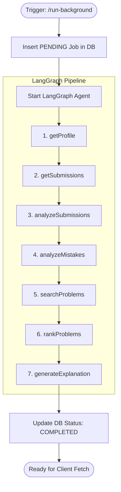

# Problem Recommendation Agent

This directory contains the **Problem Recommendation Agent**, an AI-powered state machine built with LangGraph. It is designed to act as an asynchronous background worker that intelligently selects the next best problem for a user to solve based on their recent activity, weaknesses, and performance.

---

## 🏗 Architecture Overview

The agent is implemented as a **LangGraph state graph** (`problemRecommendationGraph.ts`). It executes a sequence of nodes, passing a shared `State` object between them.

### Pipeline Node Details
1. **`getProfile`**: Retrieves the user's `UserProfile` (which contains stats, level, etc.).
2. **`getSubmissions`**: Fetches the user's last 100 submissions (`SUBMISSION_HISTORY_LIMIT`).
3. **`analyzeSubmissions`**: Evaluates the recent submission history to determine:
   - **Target difficulty** (Easy, Medium, Hard)
   - **Weak topics** (topics where the user struggles)
4. **`analyzeMistakes`**: Uses heuristic regex pattern matching (via `analyze-mistake-patterns.tool.ts`) to read the stderr/stdout of recent failed submissions and identify the primary mistake pattern (e.g., "Off-by-one error", "Timeout").
5. **`searchProblems`**: Queries the database for unsolved problems that match the weak topics and target difficulty.
6. **`rankProblems`**: Scores the candidate problems using strict weights:
   - Topic Match: +50 pts
   - Weak Topic Match: +100 pts
   - Difficulty Bonus: Easy (+75), Medium (+80), Hard (+30)
7. **`generateExplanation`**: Uses the **Groq LLM (Llama 3.3)** to generate a short, personalized 2-3 sentence explanation of *why* this problem was recommended, referencing the user's recent mistakes and weak topics.

---

## ⚡ Asynchronous Execution & Job Queue

Because LLM API calls can be subject to rate-limiting and latency, the agent is strictly designed to run asynchronously in the background.

**The Polling Flow:**
1. A client triggers `POST /api/ai/problem-recommendation/run-background`.
2. The server immediately returns a `202 Accepted` response.
3. The server inserts a `PENDING` record into the `Recommendation` PostgreSQL table.
4. The LangGraph agent runs asynchronously in Node's background loop.
5. Upon completion, the database record is updated to `COMPLETED` and the full recommendation data is saved.
6. If the agent fails, it safely updates to `FAILED`. 
   > **Stuck Job Protection:** To prevent zombie jobs from locking up the UI, the backend includes an automatic cleanup routine. Any `PENDING` jobs older than 2 minutes are instantly flagged as `FAILED` during deduplication checks, allowing new requests to pass through.

---

## 🔌 Frontend Integration

The frontend integrates with this agent through a reactive polling mechanism to ensure the user never gets locked out of the UI while waiting.

1. **Triggering:** The Practice code editor automatically triggers `/run-background` whenever a user receives an "Accepted" submission.
2. **Fetching Latest:** The Dashboard and Roadmap UI fetch `GET /api/ai/problem-recommendation/latest`.
   - **Crucial Caching Rule:** You must include strict cache-busting headers (`Cache-Control: no-cache, no-store`) on this GET request to prevent aggressive browser caching from serving stale recommendations.
3. **Polling:** The `/latest` endpoint returns an `isUpdating` boolean. If `isUpdating: true`, the frontend UI displays a loading spinner and polls `/latest` every 3 seconds until it returns `isUpdating: false`.

---

## 🛡 Error Handling & Fallbacks

The agent is designed for 100% resilience against external API failures.

- **Mistake Analysis Fallback:** If pattern matching fails, the agent assigns a primary mistake of `"None"`. The pipeline continues without crashing.
- **Explanation Fallback:** If the Groq API fails during `generateExplanation` (e.g., due to rate limits or missing API keys), it skips the LLM and falls back to a statically generated dynamic string: 
  > *"Based on your recent performance, we recommend tackling [Problem]. This will help strengthen your skills in [Topic]."*

---

## 📊 Observability (Langfuse)

Because this agent strictly relies on the central `providers/groq/index.ts` utility for its LLM calls, it automatically inherits full Langfuse tracing.

- **Trace Name:** `mentor-agent.groq`
- **Telemetry:** Captures input prompts, output generations, token usage, and latency. 
- **Requirements:** Ensure `LANGFUSE_PUBLIC_KEY`, `LANGFUSE_SECRET_KEY`, and `LANGFUSE_HOST` are configured in `.env` for analytics to transmit.
